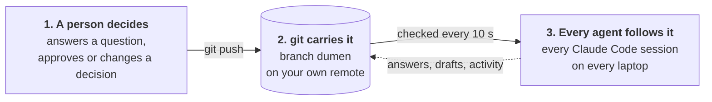

<div align="center">

# dumen

**Keep every Claude Code agent on your team working toward the same product.**

Your agents ask "A or B?". dumen remembers the answer, for every agent, on every laptop.

[](LICENSE)


</div>

Several developers run Claude Code at the same time, each on a different part of one product.
Every agent asks its human questions while it works: slot buttons or a calendar? Refund to the
card or as store credit? A new table or a column? The answer lands in one chat and is gone.
The next agent, on the next laptop, asks again, or guesses differently.

dumen turns those answers into **team decisions**: one sentence that every agent follows, of
any kind (product, UX, UI, architecture, technical). A decision is binding but changeable. Any
team member puts one in force, anyone can change it, and every change reaches the other agents
as news. It runs on the git remote you already have, with no server.

## Install: it is a Claude Code plugin

You need `git` and Claude Code. dumen uses the SSH keys or credential helper your `git`
already has.

**1. Add the plugin** (inside Claude Code):

```text
/plugin marketplace add nurettincoban/dumen
/plugin install dumen@dumen
```

The plugin brings the hooks, the MCP tools and the skill. The first time Claude Code
starts its MCP server, the plugin downloads the `dumen` binary for your system from the
latest GitHub release and checks it against the release's checksums. A `dumen` already on
your PATH is used instead. Until the first release is published, install it yourself with
`go install github.com/nurettincoban/dumen/cmd/dumen@latest`.

**2. Restart Claude Code once**, so the hooks find the downloaded binary.

**3. Ask your agent to set it up.** From here on you only talk to Claude. This is a real
session, shortened, with the store's address replaced; the permission prompt line is the text
dumen gives Claude Code to show:

```text
> Set up dumen for our team in this repository. The team store is
  git@git.example.com:team/dumen-store.git#dumen and the project is called shop.

⏺ Bash(dumen init -project shop -store git@git.example.com:team/dumen-store.git#dumen; dumen status)
  ⎿ Created branch "dumen" on git@git.example.com:team/dumen-store.git with you (maya@example.com) as lead.
    Wrote .dumen. Commit it so teammates can run `dumen join`.
    This repository is "booking-svc" in project "shop". Limit a path to it by writing booking-svc:src/...
    ...
⏺ Dumen is set up for the shop project: `dumen init` created the `dumen` branch in the team
  store and wrote `.dumen` in booking-svc, with you as lead (maya@example.com) ...

> Add ayse@example.com to the dumen team as a dev.

⏺ dumen · set_role({"email":"ayse@example.com","role":"dev"})
  Claude Code: dumen: changing who is on the team is a human action. It gives
  ayse@example.com the role "dev". Confirm only if you, the human, want this.   ▸ Yes
  ⎿ ayse@example.com now has the role dev.
```

Teammates do the same: they install the plugin and say "join our dumen project". Their agent
runs `dumen join`. The store holds your teammates' email addresses and one-line summaries of
what their agents did, so **never keep it in a public repository**; see
[Set up the store](docs/usage.md#set-up-the-store).

## Real sessions

The transcripts below come from real Claude Code sessions run by dumen's end-to-end tests
([test/e2e/decisions_test.go](test/e2e/decisions_test.go)), shortened and with temporary
paths removed. The full recordings are in [docs/transcripts](docs/transcripts). A
table-reservation product: Sofia works on the site (`web-app`) and Ayşe on `booking-svc`, each
in their own Claude Code session, with one dumen store for both repositories.

### The frontend decides, and the backend hears it in the session it is running

Sofia asked her agent how the time picker should show availability and answered "slot
buttons show how many tables are left". The backend does not return that yet. Her agent saves
the answer, says what it needs from `booking-svc`, and Sofia confirms the prompt:

```text
⏺ dumen · record_answer({"question":"How should the time picker show availability?",
    "answer":"Slot buttons show how many tables are left",
    "rule":"Time picker slot buttons show how many tables are left for that slot.",
    "kind":"ui","services":["web-app"],"topics":["booking-flow"],
    "needs":{"booking-svc":"Return remaining tables per slot in GET /slots"}})
  ⎿ Saved as D-DW4S (proposed, ui). Tell your human in one line. Your human can put it in
    force now: offer it, and if they agree call approve with this id (they confirm the prompt). ...
⏺ dumen · approve({"id":"D-DW4S"})                                    ▸ Yes
  ⎿ D-DW4S is now approved.
    note: D-DW4S asks booking-svc to: Return remaining tables per slot in GET /slots (its agents get this as news)
```

At that moment Ayşe's agent was in the middle of a 35-second check in `booking-svc`. On its
next step, in the same session, dumen handed it the news. Its answer to Ayşe:

```text
⏺ Team changes: Yes. A teammate (sofia@example.com) approved decision D-DW4S during this
  session. It is a UI decision: time picker slot buttons show how many tables are left for
  each slot. It is binding now. For this service it means `GET /slots` must return the
  remaining tables per slot. Right now `slots.List()` returns nothing, so that work is not
  started.
```

What dumen put in front of the agent is the news block below (recorded from Sofia's own
session, where the Stop hook shows it too):

```text
[dumen] DECISION NEWS (1): approved by a teammate since this session started; binding from now on
- D-DW4S [ui] Time picker slot buttons show how many tables are left for that slot. (approved by you)
  needs work from: booking-svc
Follow them from now on. If one changes what you are doing, or NEEDS work from this service,
tell your human in one line; a decision replaced by another is no longer in force. ...
```

### The agent looks before it asks

The team had already decided that cancelled bookings are refunded as store credit. A
developer building the cancel endpoint says "check before you ask me card or store credit":

```text
⏺ dumen · decisions_for_topic({"topic":"payments"})
  ⎿ Approved decisions on topic payments (1):
    - D-7TCH [product] Cancelled bookings are refunded as store credit (product-wide; topics: payments)
    Follow them; do not ask your human again what they settle. get_decision has the reasons.
⏺ The team already decided this. Decision D-7TCH (product-wide, topic: payments, approved):
  "Cancelled bookings are refunded as store credit." ... So I won't ask whether the refund goes
  to the card or to store credit. ...
  One thing the decision doesn't settle is the amount of store credit. I'll assume the full
  amount paid for the booking ... Do you want a different amount, such as a cancellation fee?
```

The agent asked only what was still open. When an agent is about to ask a question the team
already answered, with Claude Code's question tool, dumen also holds the question back once
and shows the decision.

### Two backend developers, one product

Recorded in interactive Claude Code, two terminals side by side
([full excerpt](docs/transcripts/interactive-two-backends.txt)). Ayşe is adding guest
cancellation to `booking-svc`; her agent checks the team's decisions, finds none, and asks:

```text
● Nothing in the team's decisions covers this yet, so I'll ask you.
 ☐ Cancel money
│ When a guest cancels a booking, what happens to the money: refund to the original card, or store credit?
  1. Refund to card
❯ 2. Store credit
```

It saves her pick as D-TKB0 and asks whether to put it in force. She says yes, and Claude
Code shows the permission prompt dumen asked for:

```text
 dumen — Approve Tool: (MCP)
 │ dumen: approving a decision (D-TKB0) is a human action. It puts in force D-TKB0 [product] "When a guest cancels a booking, the money is
 │ returned as store credit usable on future bookings, not refunded to the original card.". Confirm only if you, the human, want this.
 Do you want to proceed?
 ❯ 1. Yes
```

In the same minute Mehmet's agent in `billing-svc` was running a 75-second test before writing
a refund endpoint. When it finished, it told Mehmet:

```text
● The baseline passed (sh test.sh exited 0), and I added the skeleton at src/refund.go. ...
  A teammate's decision just came in: D-TKB0 (product, approved by ayse, in booking-svc)
  says a guest cancelling a booking gets store credit for future bookings, not a refund
  to the original card. That affects this endpoint. If refunds here are cancellation
  refunds, RefundBooking should issue store credit rather than call the card processor.
  Do you want it to follow that rule, or is this a different kind of refund, such as a
  billing dispute?
```

If Mehmet later learns that store credit breaks the accounting rules in one country, he tells
his agent to change it; the agent calls `supersede`, he confirms, and every agent on payments
hears the replacement as news. Choosing "Yes, and don't ask again" for `approve` does not
skip the prompt: the recording shows the next approval asking again.

Other decisions such a team keeps: "Only billing-svc talks to the payment provider"
(architecture), "A booking is held for 10 minutes while the guest pays" (product), "Creating a
booking is idempotent with an Idempotency-Key header" (technical).

## Who does what

Nobody learns a new command. People talk to Claude as usual; the commands and tools are the
agent's.

| The agent does it | A person decides, inside Claude Code |
| --- | --- |
| **Sets dumen up** and joins teammates' machines, from its own shell | **Asks for it**: "set up dumen", "join our project" |
| **Sees the decisions** for its service and the product-wide ones at session start | **Answers the agent's question**, as they already do |
| **Looks before it asks**: decisions on the topics of the prompt, the plan, the question | **Puts the answer in force** with one Yes in the permission prompt |
| **Saves an answer** as a proposed decision, with what it needs from other services | **Changes a decision** (supersede) when the team learns more |
| **Gets news** when a teammate approves or replaces a decision | **Publishes a directive** (PM or lead): "Freeze billing auth for release week" |
| **Reports** when it is blocked, waiting for its human, or finished | **Adds teammates** and names the product's services and topics |

**An agent cannot approve on its own.** Every human action (approve, reject, supersede,
publish or withdraw a directive, change roles or the product, confirm a link, turn monitoring
off) goes through Claude Code's permission prompt, and the prompt says exactly what will
happen. Agents only ever receive decisions a person approved. This is a guard rail, not a
security boundary: see [Security model](docs/security.md).

## How it works



1. **A person decides.** An approved decision becomes one small commit.
2. **git carries it.** Records live on a branch named `dumen` of a repository your team can
   already push to. GitHub, GitLab, Gitea, Bitbucket or a bare repository all work the same:
   if `git push` works, dumen works. No server, no account, no token.
3. **Every agent follows it, in the session it is running.** Each Claude Code session checks the
   branch about every 10 seconds; no restart is needed.
   Hooks read a local cache in a few milliseconds: they show the decisions at session start,
   hand over news, note the decisions on a prompt's or a plan's topics, and hold back a
   question the team already answered.

Your code never leaves your machine. dumen stores what people and agents write for the team
(decisions, the questions they answer, directive texts, links with one-line labels) and, for
activity, file paths and a one-line summary of the agent's last message with code removed. It
never stores file contents, prompts or tool output.

## What you get

- **Decisions of every kind.** Product, UX, UI, architecture and technical, each with a
  one-sentence rule, the services and topics it applies to, and a body with why, what is
  allowed and not, and the options not taken. Teams can add kinds of their own.
- **Ask once.** An answer to an agent's question becomes a decision, with the question and
  the picked option, and dumen holds back the same question later.
- **News, mid-session.** A decision approved or replaced anywhere reaches the agents it
  concerns on their next step, with what it needs from their service, and the next session
  opens with what changed.
- **Look before you ask.** Decisions on the topics of a prompt or a plan are shown to the
  agent; `decisions_for_topic` answers "did we decide this?".
- **Directives.** Short-lived instructions for every agent, one role, one area or some
  paths. `deny` directives also block edits: "Auth is frozen until the audit ends".
- **Sources of truth.** Point at a Claude Design file, an Artifact, a pull request or a doc.
  dumen keeps the link and a one-line label, and never fetches a URL.
- **An activity log.** Ask your agent who started, who finished, who is blocked, who waits
  for a human.
- **Many repositories, one product.** One store for all your services; a decision can name
  the services it applies to.
- **A check on the diff for CI.** `dumen check` fails when a change touches a frozen path,
  whatever tool made it.
- **Private sessions** and **a secret scan on every write**.

## Honest limits

dumen is early and not released yet. It is tested on Linux, including end-to-end tests against
the real `claude` CLI; it compiles for macOS and Windows and has not been run there.

- **A guard rail, not a security boundary.** It guards against agents, not colleagues: anyone
  who can `git push` to the store can forge a record.
- **`deny` blocks Claude Code's file tools.** An agent that runs `sed -i` through Bash can still
  change a frozen file. Agents are told not to, and nearly always comply. dumen does not undo
  such a change; it reports it in the activity log, and `dumen check` fails on it in CI.
- **About 10 seconds, then the next step.** News reaches a working agent on its next tool
  call or prompt, or before it stops. An agent waiting for its human hears it with the next
  message.
- **Topic matching is by keywords.** It finds decisions whose topic words appear in a
  prompt, plan or question. It does not understand meaning, so it can miss a decision or
  show an unrelated one; asking again always goes through.
- **Claude Code only, small teams.** Built for about 2 to 20 people.
- **No release is published yet.** Until the first version tag, the plugin cannot download
  the binary, and each machine needs `go install`. The download covers Linux and macOS on
  amd64 and arm64; on Windows, install the binary with `go install` (the release has
  Windows builds to put on PATH).
- **Everyone needs git access to the store**, including product managers.

The full list is in [Limits](docs/limits.md), and the reasoning in [Security model](docs/security.md).

## Documentation

| Page | What is in it |
| --- | --- |
| [Using dumen](docs/usage.md) | What to say to your agent for setup, decisions, directives, links, monitoring, several repositories, privacy |
| [Reference](docs/reference.md) | The agent's interface: MCP tools, hooks, CLI commands and flags, environment variables, data layout |
| [Security model](docs/security.md) | What an agent can and cannot do, how human actions stay human, what to protect |
| [Limits](docs/limits.md) | Everything dumen does not do yet |
| [Design](docs/design.md) | Why it is built this way |
| [The gauntlet](docs/gauntlet.md) | How every pull request is reviewed |

## Contributing

```sh
git clone https://github.com/nurettincoban/dumen && cd dumen
go build ./cmd/dumen
go test ./... -short
```

Three rules: hooks stay fast and fail open, a write never merges text, and nothing copies code
or secrets into the store. Please open an issue before a large change. More in
[Reference](docs/reference.md#development).

## License

[Apache-2.0](LICENSE). The name comes from "dümen", the Turkish word for rudder.
