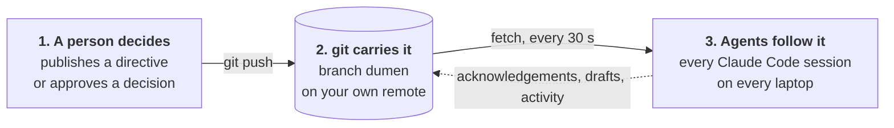

<div align="center">

# dumen

**Steer all your team's Claude Code agents from one place, with no server.**

Your agents write the code. dumen keeps them on the team's rules.

[](LICENSE)


</div>

Every developer on a team now runs several Claude Code agents. Those agents do not know that
`src/auth` is frozen for the audit, what the team decided yesterday, or that another agent is
stuck. dumen tells them, through the git remote you already have.

```console
$ dumen direct --deny --paths 'src/auth/**' --for 3d "Auth is frozen until the audit ends"
Published Y-2APW [deny] paths src/auth/**, until 2026-11-24 00:34
```

Within about 30 seconds, a teammate's running agent that tries to edit `src/auth/login.go` is
stopped and told why:

```text
Blocked by team directive Y-2APW ("Auth is frozen until the audit ends", active until
2026-11-24 00:34). This path is frozen for every agent. Do not work around it with another
tool. Ask your human.
```

## Who does what

Once dumen is installed, nobody has to learn a new command. People talk to Claude as usual. The
agent uses dumen by itself, and asks its human whenever a person has to decide.

| The agent does it on its own | The human decides |
| --- | --- |
| **Receives directives** at session start, and mid-session on its next tool call | **Publishes a directive** (PM or lead): "Freeze auth for release week" |
| **Acknowledges** each new directive, so the team sees who got it | **Approves a decision** an agent drafted. Until then it is only a proposal |
| **Stops at frozen paths.** An edit under a `deny` directive is blocked | **Answers the agent** when it is blocked or asks a question |
| **Reads the decisions and design links** that govern a file before changing it | **Withdraws a directive** when it is no longer needed |
| **Drafts a decision** when it makes a lasting choice: a library, an API shape | **Confirms a link** an agent added, before other agents see it |
| **Reports** when it is blocked, waiting for its human, or finished | |

**An agent cannot approve through its tools.** Publishing a directive and approving or
superseding a decision go through Claude Code's own permission prompt, where a person answers
Yes or No. The same actions are available from a terminal with the `dumen` CLI. This is a guard
rail, not a security boundary: see [Security model](docs/security.md).

## How it works



1. **A person decides.** A directive or an approved decision becomes one small commit.
2. **git carries it.** Records live on a branch named `dumen` of a repository your team can
   already push to. GitHub, GitLab, Gitea, Bitbucket or a bare repository all work the same:
   if `git push` works, dumen works. No server, no account, no token.
3. **Agents follow it.** Each Claude Code session checks the branch every 30 seconds. Hooks read
   a local cache in about 4 ms, hand new directives to the agent and block edits to frozen paths.

Your code never leaves your machine. dumen stores what people and agents write for the team
(directive texts, decision titles and bodies, links with one-line labels) and, for activity,
file paths and a one-line summary of the agent's last message with code removed. It never
stores file contents, prompts or tool output.

## Quickstart

You need `git`, Go 1.25 or newer, and Claude Code. dumen uses the SSH keys or credential helper
your `git` already has.

**1. Install the binary** (everyone)

```sh
go install github.com/nurettincoban/dumen/cmd/dumen@latest
```

**2. Create the store** (one person, once, inside your code repository)

```sh
dumen init
git add .dumen && git commit -m "Add dumen" && git push
dumen role set ayse@example.com dev      # teammates, by their git user.email
```

```text
Created branch "dumen" on git@git.example.com:team/shop.git with you (maya@example.com) as lead.
Wrote .dumen. Commit it so teammates can run `dumen join`.
...
```

The store holds your teammates' email addresses and one-line summaries of what their agents
did. **Never keep it in a public repository.** For a public or busy repository, give the store
a private repository of its own: see [Set up the store](docs/usage.md#set-up-the-store).

**3. Connect Claude Code** (each developer, once, inside Claude Code)

```text
/plugin marketplace add nurettincoban/dumen
/plugin install dumen@dumen
```

**4. Join** (every other developer, once per machine)

```sh
git pull && dumen join
```

```text
Joined project "shop" as ayse@example.com, role: dev.
```

That is all. Start Claude Code as usual, then publish the directive from the top of this page and
watch `dumen activity`.

## What you get

- **Directives.** Tell every agent, one role, one area or some paths. `context` directives
  inform; `deny` directives also block edits. Every directive expires.
- **Shared decisions.** Agents see the approved decisions that govern the files they touch.
  Agents draft, people approve.
- **Sources of truth.** Point at a Claude Design file, an Artifact, a pull request or a doc.
  dumen keeps the link and a one-line label, and never fetches a URL.
- **An activity log.** Who started, who finished, who is blocked, who waits for a human, and
  who has not acknowledged a directive yet.
- **Many repositories, one team.** One store for all your services, with scopes such as
  `orders:migrations/**`.
- **Private sessions.** `dumen private on` stops activity from your sessions. The team sees
  only that a private session ran.
- **A secret scan on every write.** A record that looks like it holds a key or token is rejected.

## Honest limits

dumen is early and not released yet. It is tested on Linux, including end-to-end tests against
the real `claude` CLI; it compiles for macOS and Windows and has not been run there.

- **A guard rail, not a security boundary.** It guards against agents, not colleagues: anyone
  who can `git push` to the store can forge a record.
- **`deny` covers Claude Code's file tools.** An agent that runs `sed -i` through Bash can still
  change a frozen file. Agents are told not to, and nearly always comply. Use branch protection
  and review for hard guarantees.
- **About 30 seconds to arrive.** A new directive is not instant.
- **Claude Code only, small teams.** Built for about 2 to 20 people.
- **Everyone needs git access to the store**, including product managers.

The full list is in [Limits](docs/limits.md), and the reasoning in [Security model](docs/security.md).

## Documentation

| Page | What is in it |
| --- | --- |
| [Using dumen](docs/usage.md) | Store setup, directives, decisions, links, monitoring, several repositories, privacy |
| [Reference](docs/reference.md) | Every command and flag, environment variables, MCP tools, hooks, data layout |
| [Security model](docs/security.md) | What an agent can and cannot do, how human actions stay human, what to protect |
| [Limits](docs/limits.md) | Everything dumen does not do yet |
| [Design](docs/design.md) | Why it is built this way |
| [The gauntlet](docs/gauntlet.md) | How every pull request is reviewed |

## Contributing

```sh
git clone https://github.com/nurettincoban/dumen && cd dumen
go build ./cmd/dumen
go test ./... -short
```

Three rules: hooks stay fast and fail open, a write never merges text, and nothing copies code
or secrets into the store. Please open an issue before a large change. More in
[Reference](docs/reference.md#development).

## License

[Apache-2.0](LICENSE). The name comes from "dümen", the Turkish word for rudder.
