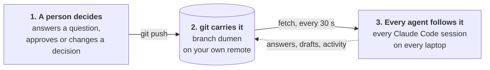

<div align="center">

# dumen

**Keep every Claude Code agent on your team working toward the same product.**

Your agents ask "A or B?". dumen remembers the answer, for every agent, on every laptop.

[](LICENSE)


</div>

Several developers run Claude Code at the same time, each on a different part of one product.
Every agent asks its human questions while it works: slot buttons or a calendar? Refund to the
card or as store credit? A new table or a column? The answer lands in one chat and is gone.
The next agent, on the next laptop, asks again, or guesses differently.

dumen turns those answers into **team decisions**: one sentence that every agent follows, of
any kind (product, UX, UI, architecture, technical). A decision is binding but changeable. Any
team member puts one in force, anyone can change it, and every change reaches the other agents
as news. It runs on the git remote you already have, with no server.

## An example: a table-reservation product

Ayşe works on `booking-svc`, Mehmet on `billing-svc`, both with Claude Code. One dumen store
serves both repositories.

**1. Ayşe's agent asks, Ayşe answers, the answer becomes a decision.** Her agent is building
cancellation and needs to know what happens to the money. It asks with Claude Code's question
tool. Ayşe picks "store credit". The agent saves the answer and offers to put it in force:

```text
⏺ dumen · record_answer("What happens to the money when a guest cancels?",
                         "Store credit", kind product, topics payments)
  ⎿ Saved as D-7K2P (proposed, product). Your human can put it in force now ...
⏺ dumen · approve(D-7K2P)
  Claude Code: dumen: approving a decision (D-7K2P) is a human action. It puts in force
  D-7K2P [product] "Cancelled bookings are refunded as store credit". Allow?  ▸ Yes
```

**2. Mehmet's agent hears about it on its next step.** It is in the middle of a refund
endpoint in `billing-svc`. Its next tool call carries the news:

```text
[dumen] DECISION NEWS (1): approved by a teammate since this session started; binding from now on
- D-7K2P [product] Cancelled bookings are refunded as store credit (approved by ayse@example.com; in booking-svc)
Follow them from now on. If one changes what you are doing, tell your human in one line ...
```

**3. Nobody asks the same question twice.** A week later Sofia's agent in `web-app` is about
to ask her "refund to the card, or store credit?" for the cancel screen. dumen holds the
question back once and shows the answer the team already gave:

```text
dumen: the team may already have decided this. This approved decision looks related:
- D-7K2P [product] Cancelled bookings are refunded as store credit
If one of them answers your question, follow it and tell your human which decision you
followed; do not ask. ...
```

**4. Changing your mind is one step, and it is news too.** Mehmet learns that store credit
breaks the accounting rules in one country. He asks his Claude to supersede D-7K2P with
"Cancelled bookings are refunded to the card", confirms the prompt, and every agent working on
payments gets "D-9QXA ... replaces D-7K2P" on its next step. `dumen news` shows the same to
people:

```text
$ dumen news --all
Decisions in force for this project since 2026-11-14 10:00 (2), newest first

11-21 15:02  D-9QXA  product      Cancelled bookings are refunded to the card
                    approved by mehmet@example.com in billing-svc; applies to all (product-wide)
                    replaces D-7K2P: Cancelled bookings are refunded as store credit
11-21 11:40  D-7K2P  product      Cancelled bookings are refunded as store credit
...
```

(The output above follows dumen's messages, shortened; it was not recorded from one session.)

Other decisions the same team keeps: "Only billing-svc talks to the payment provider"
(architecture), "Guests pick a time from slot buttons grouped by part of day" (UI), "A
booking is held for 10 minutes while the guest pays" (product), "Creating a booking is
idempotent with an Idempotency-Key header" (technical).

## Who does what

Once dumen is installed, nobody has to learn a new command. People talk to Claude as usual.

| The agent does it on its own | A person decides |
| --- | --- |
| **Sees the decisions** for its service and the product-wide ones at session start | **Answers the agent's question**, as they already do |
| **Looks before it asks**: decisions on the topics of the prompt, the plan, the question | **Puts the answer in force** with one Yes in the permission prompt |
| **Saves an answer** as a proposed decision with the question it came from | **Changes a decision** (supersede) when the team learns more |
| **Gets news** when a teammate approves or replaces a decision | **Publishes a directive** (PM or lead): "Freeze billing auth for release week" |
| **Reports** when it is blocked, waiting for its human, or finished | |

**An agent cannot approve through its tools.** Approving or superseding a decision and
publishing a directive go through Claude Code's own permission prompt, where a person answers
Yes or No, and agents only ever receive decisions a person approved. The same actions are
available from a terminal with the `dumen` CLI. This is a guard rail, not a security boundary:
see [Security model](docs/security.md).

## How it works



1. **A person decides.** An approved decision becomes one small commit.
2. **git carries it.** Records live on a branch named `dumen` of a repository your team can
   already push to. GitHub, GitLab, Gitea, Bitbucket or a bare repository all work the same:
   if `git push` works, dumen works. No server, no account, no token.
3. **Every agent follows it.** Each Claude Code session checks the branch every 30 seconds.
   Hooks read a local cache in a few milliseconds: they show the decisions at session start,
   hand over news, note the decisions on a prompt's or a plan's topics, and hold back a
   question the team already answered.

Your code never leaves your machine. dumen stores what people and agents write for the team
(decisions, the questions they answer, directive texts, links with one-line labels) and, for
activity, file paths and a one-line summary of the agent's last message with code removed. It
never stores file contents, prompts or tool output.

## Quickstart

You need `git`, Go 1.25 or newer, and Claude Code. dumen uses the SSH keys or credential helper
your `git` already has.

**1. Install the binary** (everyone)

```sh
go install github.com/nurettincoban/dumen/cmd/dumen@latest
```

**2. Create the store** (one person, once, inside your code repository)

```sh
dumen init
git add .dumen && git commit -m "Add dumen" && git push
dumen role set ayse@example.com dev      # teammates, by their git user.email
```

```text
Created branch "dumen" on git@git.example.com:team/shop.git with you (maya@example.com) as lead.
Wrote .dumen. Commit it so teammates can run `dumen join`.
...
```

The store holds your teammates' email addresses and one-line summaries of what their agents
did. **Never keep it in a public repository.** For a public or busy repository, give the store
a private repository of its own: see [Set up the store](docs/usage.md#set-up-the-store).

**3. Connect Claude Code** (each developer, once, inside Claude Code)

```text
/plugin marketplace add nurettincoban/dumen
/plugin install dumen@dumen
```

**4. Join** (every other developer, once per machine)

```sh
git pull && dumen join
```

```text
Joined project "shop" as ayse@example.com, role: dev.
```

That is all. Start Claude Code as usual. Optionally tell dumen your services and the words of
your product, so it can match decisions to what people ask for:

```sh
dumen product --name "Table reservations" \
  --service booking-svc="Creates, changes and cancels bookings" \
  --service billing-svc="Payments and refunds" \
  --service web-app="The guest-facing site" \
  --topic payments=refund,charge,card,deposit \
  --topic booking-flow="booking page,time picker,slot"
```

## What you get

- **Decisions of every kind.** Product, UX, UI, architecture and technical, each with a
  one-sentence rule, the services and topics it applies to, and a body with why, what is
  allowed and not, and the options not taken. Teams can add kinds of their own.
- **Ask once.** An answer to an agent's question becomes a decision, with the question and
  the picked option, and dumen holds back the same question later.
- **News.** A decision approved or replaced anywhere reaches the agents it concerns on their
  next step, and the next session opens with what changed. `dumen news` is the same for
  people.
- **Look before you ask.** Decisions on the topics of a prompt or a plan are shown to the
  agent; `decisions_for_topic` answers "did we decide this?".
- **Directives.** Short-lived instructions for every agent, one role, one area or some
  paths. `deny` directives also block edits: "Auth is frozen until the audit ends".
  
- **Sources of truth.** Point at a Claude Design file, an Artifact, a pull request or a doc.
  dumen keeps the link and a one-line label, and never fetches a URL.
- **An activity log.** Who started, who finished, who is blocked, who waits for a human.
- **Many repositories, one product.** One store for all your services; a decision can name
  the services it applies to.
- **A check on the diff.** `dumen check` fails when a change touches a frozen path, whatever
  tool made it. Run it in CI or before a push.
- **Private sessions** and **a secret scan on every write**.

## Honest limits

dumen is early and not released yet. It is tested on Linux, including end-to-end tests against
the real `claude` CLI; it compiles for macOS and Windows and has not been run there.

- **A guard rail, not a security boundary.** It guards against agents, not colleagues: anyone
  who can `git push` to the store can forge a record.
- **`deny` blocks Claude Code's file tools.** An agent that runs `sed -i` through Bash can still
  change a frozen file. Agents are told not to, and nearly always comply. dumen does not undo
  such a change; it reports it in `dumen activity`, and `dumen check` fails on it in CI.
- **About 30 seconds to arrive.** News and new directives are not instant.
- **Topic matching is by keywords.** It finds decisions whose topic words appear in a
  prompt, plan or question. It does not understand meaning, so it can miss a decision or
  show an unrelated one; asking again always goes through.
- **Claude Code only, small teams.** Built for about 2 to 20 people.
- **Everyone needs git access to the store**, including product managers.

The full list is in [Limits](docs/limits.md), and the reasoning in [Security model](docs/security.md).

## Documentation

| Page | What is in it |
| --- | --- |
| [Using dumen](docs/usage.md) | Store setup, directives, decisions, links, monitoring, several repositories, privacy |
| [Reference](docs/reference.md) | Every command and flag, environment variables, MCP tools, hooks, data layout |
| [Security model](docs/security.md) | What an agent can and cannot do, how human actions stay human, what to protect |
| [Limits](docs/limits.md) | Everything dumen does not do yet |
| [Design](docs/design.md) | Why it is built this way |
| [The gauntlet](docs/gauntlet.md) | How every pull request is reviewed |

## Contributing

```sh
git clone https://github.com/nurettincoban/dumen && cd dumen
go build ./cmd/dumen
go test ./... -short
```

Three rules: hooks stay fast and fail open, a write never merges text, and nothing copies code
or secrets into the store. Please open an issue before a large change. More in
[Reference](docs/reference.md#development).

## License

[Apache-2.0](LICENSE). The name comes from "dümen", the Turkish word for rudder.
